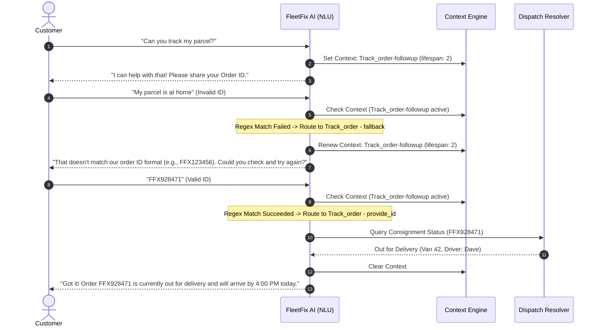

# FleetFix AI — Autonomous Logistics & Last-Mile Issue Resolution Agent

[](https://dialogflow.cloud.google.com/)
[](#contributors--academic-metadata)
[](#system-architecture--state-machine)
[](https://github.com/parthibcpana/IDAI101-1000544-PARTH-PARVINBHAI-GAJERA)

**Course:** Artificial Intelligence: Real-World Applications and Implications (`IDAI101`)  
**Assessment:** Formative Assessment-2 (FA-2: Conversational AI Implementation)  
**Enterprise Scenario:** SwiftShip Logistics Pvt. Ltd. — Dispatch & Delivery Operations  
**Architecture:** Intent-Entity NLP with Two-Tier Context Fallback State Machine  

---

## Project Overview and Operational Problem Analysis

Last-mile delivery networks operate under strict time windows and high package volumes. SwiftShip Logistics Pvt. Ltd. processes thousands of shipments every day across inter-city and intra-city logistics hubs. As delivery volumes increased, customer support channels experienced significant strain due to repetitive inquiries and delayed ticket processing.

### Industry Challenges in Last-Mile Logistics

Customer support data in shipping and e-commerce consistently indicates that between 45% and 60% of inbound communications consist of "Where Is My Order" (WISMO) requests. In peak fulfillment periods, weather-related delays, traffic congestion, and terminal transfers generate surges in customer inquiries that overwhelm manual support teams.

When packages arrive damaged, stolen, or delayed, traditional resolution pipelines require customers to submit tickets via email or web forms. This multi-step process introduces 48 to 72 hours of turnaround latency, directly contributing to customer churn and low service ratings. Meanwhile, front-line support staff spend most of their working hours looking up order numbers instead of handling complex logistics exceptions.

### FleetFix AI Scope and Objectives

FleetFix AI is engineered as an automated first-line conversational interface integrated directly into the customer dispatch lifecycle. The system is designed to fulfill several operational goals:

* Provide 24/7 self-service order tracking with zero queue wait time.
* Validate consignment numbers dynamically through regex patterns before querying tracking endpoints.
* Guide customers through self-healing loops when an order identifier is entered incorrectly, preventing broken conversations.
* Diagnose transit delays and explain the underlying operational reason (such as weather, traffic, or hub transfers).
* Enable direct delivery window rescheduling and cancellation requests for eligible consignments.
* Automate claim logging for damaged or missing parcels by initiating replacement dispatches or refund claims.
* Provide seamless handoff transitions to human customer service officers whenever an issue falls outside automated resolution parameters.

---

## Visual Storyboard and Infographic

The conversational flows, user journey blueprints, and empathy models for FleetFix AI were conceptualized during the FA-1 design phase and mapped out visually in Canva.

The complete visual design, storyboard diagrams, and infographic presentation are available directly through the project canvas:

[Open FleetFix AI Storyboard and Infographic on Canva](https://www.canva.com/design/DAHV_ZklCrQ/WlejQFSclYynTTUOFVhpsg/edit)

The storyboard document establishes four essential design pillars:

* **User Personas and Empathy Mapping:** Focused on the immediate needs of recipients who require precise ETA updates, customers who received damaged goods, and users needing to adjust their delivery schedules.
* **Conversation Flow Blueprint:** Complete branching diagrams capturing every conversational state from greeting and slot extraction to final issue resolution.
* **Intent-Entity Cross-Walk:** Structural mapping that links user utterances to target entities such as `@Order_ID`, `@Issue_type`, and `@Delivery_Slot`.
* **Error Recovery Schematics:** Architectural safeguards specifying how the bot handles missing input parameters, invalid tracking syntax, and ambiguous user phrasing.

---

## System Architecture and State Machine

FleetFix AI runs on Google Dialogflow ES, utilizing custom entity models, context lifespan control, and nested child fallback structures.


### Two-Tier Context Loop Algorithm

Standard slot-filling setups in conversational systems frequently encounter an issue known as premature validation: when a slot is marked required and given multiple prompts, the platform can randomly surface an error prompt before the customer has even made their first attempt to type the information.

To eliminate this vulnerability, FleetFix AI uses a deterministic two-tier context state machine:

1. **Parent Intent Execution:**  
   When an intent like `Track_order` or `Check_delivery_delay` is matched without an order identifier, the parent intent responds with an inviting prompt and outputs an active tracking context (e.g., `Track_order-followup`) with a lifespan of 2.

2. **Regex-Matched Child Intent (`provide_id`):**  
   The child intent requires the parent's context as its input context. Its training phrases are exclusively mapped to the `@Order_ID` regex entity. When the user provides a valid tracking code, this intent fires immediately to deliver the parcel telemetry.

3. **Contextual Child Fallback Intent (`fallback`):**  
   A dedicated child fallback intent is assigned the same input context with `"fallbackIntent": true`. When an input fails regex matching, this fallback catches the error, outputs an informative message explaining the valid format, and refreshes the context lifespan so the user can re-enter their ID without losing the session flow.



---

## NLP Specifications: Entities and Regex Rules

FleetFix AI utilizes six custom entity models to extract structured parameters from conversational text:

| Entity Name | Storage Type | Regex Pattern / Synonym Set | Purpose & Application |
|---|---|---|---|
| `@Order_ID` | Regexp Entity | `FF[XZ][0-9]{6}`<br>`[A-Z]{3}[0-9]{6}`<br>`[A-Za-z]{2,4}[0-9]{5,8}` | Validates consignment keys: SwiftShip express tags (`FFX102938`), ground freight tags (`FFZ849201`), partner carriers (`EXP839201`), and legacy identifiers (`fdh3992343`). |
| `@Issue_type` | List / Enum | `damaged`, `broken`, `crushed`, `delayed`, `late`, `missing`, `lost`, `stolen`, `wrong item`, `tampered` | Classifies the problem category to direct the interaction into proper operational pathways. |
| `@Delivery_Status` | List / Enum | `Out for delivery`, `In transit`, `Dispatched`, `Delayed`, `Delivered`, `Returned to hub`, `Pending` | Identifies delivery milestones and maps them to simulated logistics events. |
| `@Cancellation_Reason` | List / Enum | `Found cheaper elsewhere`, `Delivery took too long`, `Ordered by mistake`, `Incorrect delivery address`, `Duplicate order` | Captures cancellation rationale for business operations reporting. |
| `@Delivery_Slot` | List / Enum | `Morning (9 AM - 12 PM)`, `Afternoon (12 PM - 4 PM)`, `Evening (4 PM - 8 PM)`, `Weekend Delivery` | Facilitates delivery rescheduling into pre-defined dispatch windows. |
| `@Item_Category` | List / Enum | `Electronics`, `Fragile Goods`, `Perishables`, `Documents & Contracts`, `Apparel`, `Heavy Machinery` | Supports priority tagging and determines inspection guidelines for damage claims. |

### Regex Patterns Configured for `@Order_ID`

* `FF[XZ][0-9]{6}` matches standard SwiftShip consignments where the `FF` prefix denotes FleetFix, followed by `X` (express air/van) or `Z` (ground freight), and a six-digit unique dispatch serial.
* `[A-Z]{3}[0-9]{6}` accommodates integrated freight partners using three uppercase regional airline/railroad carrier codes followed by six numbers.
* `[A-Za-z]{2,4}[0-9]{5,8}` provides a flexible case-insensitive pattern for external courier systems and e-commerce partner orders.

---

## Intent Topology and Conversation Routing

The agent includes 22 intents structured into functional operational clusters:

```
FleetFix AI Intent Architecture
├── Core Operations
│   ├── Default Welcome Intent
│   ├── Default Fallback Intent
│   └── Connect_me_with_agent
├── Order Tracking
│   ├── Track_order (Parent)
│   ├── Track_order - provide_id (Child Match)
│   ├── Track_order - fallback (Child Reprompt)
│   └── Track_order - custom
├── Delay and Exception Management
│   ├── Check_delivery_delay (Parent)
│   ├── Check_delivery_delay - provide_id (Child Match)
│   └── Check_delivery_delay - fallback (Child Reprompt)
├── Damage and Return Claims
│   ├── Report_damaged_orders (Parent)
│   ├── Report_damaged_orders - provide_id (Child Match)
│   ├── Report_damaged_orders - fallback (Child Reprompt)
│   ├── Report_damaged_orders - yes (Confirmation)
│   ├── Refund_request (Parent)
│   ├── Refund_request - provide_id (Child Match)
│   ├── Refund_request - fallback (Child Reprompt)
│   ├── Replacement_request (Parent)
│   ├── Replacement_request - provide_id (Child Match)
│   └── Replacement_request - fallback (Child Reprompt)
├── Rescheduling and Delivery Adjustments
│   ├── Reschedule_delivery (Parent)
│   ├── Reschedule_delivery - provide_id (Child Match)
│   └── Reschedule_delivery - fallback (Child Reprompt)
└── Lifecycle Modifications
    ├── Cancel_order (Parent)
    ├── Cancel_order - provide_id (Child Match)
    ├── Place_order (Parent)
    ├── Place_order - yes (Confirmation)
    └── Place_order - cancel (Abort)
```

### Context Topology Table

| Intent Display Name | Type | Input Context | Output Context (Lifespan) | Trigger Condition & Role |
|---|---|---|---|---|
| `Default Welcome Intent` | Root | None | None | Greets customer, introduces capabilities, suggests actions. |
| `Track_order` | Parent | None | `Track_order-followup` (2) | Catches tracking requests and prompts for consignment ID. |
| `Track_order - provide_id` | Child | `Track_order-followup` | None | Triggers on valid `@Order_ID` regex match to return package telemetry. |
| `Track_order - fallback` | Child | `Track_order-followup` | `Track_order-followup` (2) | Catches non-matching input, displays format guidance, and reprompts. |
| `Check_delivery_delay` | Parent | None | `Check_delivery_delay-followup` (2) | Queries shipment delay root causes and ETA adjustments. |
| `Check_delivery_delay - provide_id` | Child | `Check_delivery_delay-followup` | None | Returns verified delay reason and updated delivery window. |
| `Check_delivery_delay - fallback` | Child | `Check_delivery_delay-followup` | `Check_delivery_delay-followup` (2) | Renews context and reprompts for tracking number. |
| `Report_damaged_orders` | Parent | None | `Report_damaged_orders-followup` (2) | Opens a damage claim and requests order reference. |
| `Report_damaged_orders - provide_id` | Child | `Report_damaged_orders-followup` | `damage-reported` (2) | Confirms delivery and offers replacement or refund choices. |
| `Report_damaged_orders - fallback` | Child | `Report_damaged_orders-followup` | `Report_damaged_orders-followup` (2) | Prompts for valid order identifier. |
| `Replacement_request` | Parent | None | `Replacement_request-followup` (2) | Initiates replacement workflow for broken or defective orders. |
| `Replacement_request - provide_id` | Child | `Replacement_request-followup` | None | Books a zero-charge replacement order for delivery. |
| `Reschedule_delivery` | Parent | None | `Reschedule_delivery-followup` (2) | Opens calendar slot options for shipment delivery. |
| `Reschedule_delivery - provide_id` | Child | `Reschedule_delivery-followup` | None | Confirms updated slot selection in the dispatch system. |
| `Cancel_order` | Parent | None | `Cancel_order-followup` (2) | Checks shipment stage and executes cancellation if unfulfilled. |
| `Cancel_order - provide_id` | Child | `Cancel_order-followup` | None | Processes cancellation and triggers refund initiation. |
| `Connect_me_with_agent` | Escalation | None | None | Routes session to human agent desk with context summary. |

---

## End-to-End User Journeys

### User Journey 1: Parcel Tracking with Error Recovery Loop

```
Customer : "Hey there, where is my package?"
FleetFix : "Hello! I can definitely pull up your package status. Could you please provide your Order ID?"
Customer : "I don't know, maybe somewhere in Mumbai?"
FleetFix : "That doesn't match our order ID format (e.g., FFX123456 or EXP654321). Please check your confirmation SMS or email and try again."
Customer : "Ah found it, it's FFX928174"
FleetFix : "Got it! Consignment FFX928174 is currently Out for Delivery with Driver Dave (Van #42). Estimated delivery is today before 3:30 PM. Would you like to add delivery instructions or reschedule?"
Customer : "No, that's great! Thank you."
FleetFix : "You're very welcome! Thanks for choosing SwiftShip Logistics. Have a wonderful day!"
```

### User Journey 2: Damaged Parcel Report and Replacement Booking

```
Customer : "My package arrived completely crushed and the item inside is broken!"
FleetFix : "I am very sorry to hear that! Let's get this resolved immediately. What is the Order ID on the shipping label?"
Customer : "FFZ482910"
FleetFix : "Thank you for verifying order FFZ482910. I have logged a damage report for your shipment. Would you prefer a full refund or an immediate replacement dispatched today?"
Customer : "Please send a replacement, I need the product."
FleetFix : "Done deal! A replacement consignment has been generated under reference FFX-REP-482910 and scheduled for priority dispatch. Our courier will also collect the damaged unit during delivery."
Customer : "Perfect, thank you for making that painless."
FleetFix : "Always glad to help! You'll receive live SMS updates as soon as the replacement leaves the facility."
```

### User Journey 3: Transit Delay Diagnostic and Delivery Rescheduling

```
Customer : "Why hasn't my order arrived yet? It was supposed to be here yesterday."
FleetFix : "I understand your frustration with delivery delays. Let me check the transport telemetry for you. Could you share your Order ID?"
Customer : "EXP384920"
FleetFix : "Checking consignment EXP384920... Your shipment encountered an unexpected delay due to heavy interstate highway congestion. It has arrived at the local central sorting hub and is ready for route allocation. Would you like to keep today's evening slot or reschedule for tomorrow morning?"
Customer : "Reschedule it to tomorrow morning between 9 AM and 12 PM please."
FleetFix : "All set! Order EXP384920 is now locked in for tomorrow's Morning Slot (9:00 AM - 12:00 PM). Our dispatch team has updated your delivery manifest."
```

---

## Repository Structure and Directory Layout

```
IDAI101-1000544-PARTH-PARVINBHAI-GAJERA/
├── README.md                                    # System architecture and technical documentation
├── agent.json                                   # Dialogflow ES root agent configuration
├── package.json                                 # Package schema specification
├── entities/                                    # Entity definitions and value entries
│   ├── Cancellation_Reason.json
│   ├── Cancellation_Reason_entries_en.json
│   ├── Delivery_Slot.json
│   ├── Delivery_Slot_entries_en.json
│   ├── Delivery_Status.json
│   ├── Delivery_Status_entries_en.json
│   ├── Issue_type.json
│   ├── Issue_type_entries_en.json
│   ├── Item_Category.json
│   ├── Item_Category_entries_en.json
│   ├── Order_ID.json                            # Regular expression entity configuration
│   └── Order_ID_entries_en.json                 # Regular expression pattern sets
└── intents/                                     # Intent definitions and training phrases
    ├── Default Welcome Intent.json
    ├── Default Welcome Intent_usersays_en.json
    ├── Default Fallback Intent.json
    ├── Connect_me_with_agent.json
    ├── Connect_me_with_agent_usersays_en.json
    ├── Track_order.json
    ├── Track_order_usersays_en.json
    ├── Track_order - provide_id.json
    ├── Track_order - provide_id_usersays_en.json
    ├── Track_order - fallback.json
    ├── Check_delivery_delay.json
    ├── Check_delivery_delay_usersays_en.json
    ├── Check_delivery_delay - provide_id.json
    ├── Check_delivery_delay - provide_id_usersays_en.json
    ├── Check_delivery_delay - fallback.json
    ├── Report_damaged_orders.json
    ├── Report_damaged_orders_usersays_en.json
    ├── Report_damaged_orders - provide_id.json
    ├── Report_damaged_orders - provide_id_usersays_en.json
    ├── Report_damaged_orders - fallback.json
    ├── Report_damaged_orders - yes.json
    ├── Report_Missing_Order.json
    ├── Report_Missing_Order - provide_id.json
    ├── Report_Missing_Order - fallback.json
    ├── Refund_request.json
    ├── Refund_request - provide_id.json
    ├── Refund_request - fallback.json
    ├── Replacement_request.json
    ├── Replacement_request - provide_id.json
    ├── Replacement_request - fallback.json
    ├── Reschedule_delivery.json
    ├── Reschedule_delivery - provide_id.json
    ├── Reschedule_delivery - fallback.json
    ├── Cancel_order.json
    ├── Cancel_order - provide_id.json
    ├── Place_order.json
    ├── Place_order - yes.json
    └── Place_order - cancel.json
```

---

## Deployment and Setup Instructions

To deploy or restore the agent in Google Dialogflow ES:

1. **Clone the Repository:**
   ```bash
   git clone git@github-parthibcpana:parthibcpana/IDAI101-1000544-PARTH-PARVINBHAI-GAJERA.git
   cd IDAI101-1000544-PARTH-PARVINBHAI-GAJERA
   ```

2. **Generate the Dialogflow Archive:**
   Compress `agent.json`, `package.json`, and the `entities/` and `intents/` directories into a standard zip archive:
   ```powershell
   Compress-Archive -Path agent.json, package.json, entities, intents -DestinationPath FleetFix_AI_Agent.zip -Force
   ```

3. **Import to Dialogflow ES Console:**
   * Open the Google Dialogflow ES console.
   * Create an agent instance (e.g., `FleetFix-AI-Logistics`).
   * Navigate to Agent Settings (gear icon) > Export and Import.
   * Choose Restore from Zip (or Import from Zip) and upload `FleetFix_AI_Agent.zip`.
   * Allow the NLU model to complete its training pass.

4. **Verify Behavior in the Test Simulator:**
   * Test tracking recovery: type "Track my parcel", reply with an arbitrary text string, confirm that the fallback reprompt triggers, then reply with a valid ID such as `FFX102938`.
   * Test damage handling: type "My package arrived damaged", provide `FFZ998877`, and confirm the refund or replacement branch.

---

## Contributors & Academic Metadata

| Role | Name | Candidate Registration No. | Email |
|---|---|---|---|
| **Primary Developer** | Parth Pravinbhai Gajera | **1000544** | [parth.ibcp.ana@gmail.com](mailto:parth.ibcp.ana@gmail.com) |
| **Project Contributor** | Subhaan Imamuddin Syed | **1000545** | — |

* **Course Name:** Artificial Intelligence: Real-World Applications and Implications (`IDAI101`)
* **Academic Evaluation:** Formative Assessment - 2 (FA-2) — Practical Implementation & Deployment
* **Scenario Context:** SwiftShip Logistics Pvt. Ltd. (Customer Experience & Dispatch Automation)
